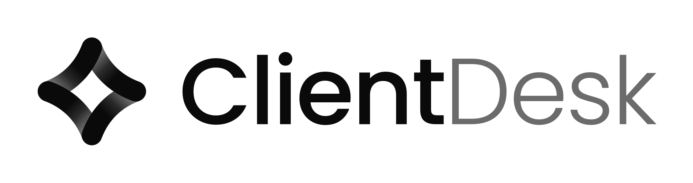

<div align="center">

<picture>
  <source media="(prefers-color-scheme: dark)" srcset="assets/brand/readme/logo-dark-mode.png">
  <source media="(prefers-color-scheme: light)" srcset="assets/brand/readme/logo-light-mode.png">
  
</picture>

<h3>Customer support, organised.</h3>

<p><strong>Every issue tracked. Every task assigned. Every resolution recorded.</strong></p>

<p>
  
  
  
  
  
  
</p>

<p>
  <a href="#overview">Overview</a> ·
  <a href="#features">Features</a> ·
  <a href="#how-it-works">How it works</a> ·
  <a href="#security">Security</a> ·
  <a href="#technology">Technology</a> ·
  <a href="#getting-started">Getting started</a> ·
  <a href="#roadmap">Roadmap</a>
</p>

</div>

---

## Overview

**ClientDesk** is a mobile-first support desk for small businesses and growing teams. It replaces scattered WhatsApp threads, spreadsheets and sticky notes with one secure workspace where every customer issue becomes a ticket that has an owner, a priority, a status and a full history.

Teams capture requests in seconds, assign them to the right person, discuss them in context and see them through to resolution. That works whether the team is online or working somewhere with poor connectivity.

<table>
  <tr>
    <td width="33%" valign="top">
      <h4>Centralised</h4>
      One workspace for every complaint, service request and technical issue, so nothing gets lost between channels.
    </td>
    <td width="33%" valign="top">
      <h4>Accountable</h4>
      Every ticket has a clear owner, priority and status, plus a timestamped record of who did what.
    </td>
    <td width="33%" valign="top">
      <h4>Always available</h4>
      You can create, update and review tickets offline. Changes sync automatically once you're back online.
    </td>
  </tr>
</table>

---

## Features

### Ticket management
The heart of ClientDesk. Each ticket holds the subject, description, customer details, priority, status, assignee and full audit timestamps.

- Create, edit, assign, resolve and close tickets
- Fast search and filtering, with paginated lists that you can pull to refresh
- Structured priorities and a clear lifecycle

| Priority | Use for | | Status | Meaning |
|---|---|---|---|---|
| **Low** | Minor issues | | **Open** | New or awaiting investigation |
| **Medium** | Standard requests | | **In Progress** | Actively being handled |
| **High** | Important issues needing attention | | **Resolved** | Issue addressed |
| **Urgent** | Critical, act immediately | | **Closed** | Support process complete |

### Team workspaces
- Separate company workspaces, with data kept isolated between them
- Invite teammates by email and manage membership
- Belong to several workspaces and switch between them easily

### Roles and permissions
Access is enforced on the server, not just hidden in the interface.

| Capability | Owner | Member |
|---|:---:|:---:|
| View, create and edit tickets | ✓ | ✓ |
| Assign tickets and update status | ✓ | ✓ |
| Comment and upload attachments | ✓ | ✓ |
| Invite and remove members | ✓ | — |
| Manage workspace settings | ✓ | — |
| Delete workspace | ✓ | — |

### Collaboration
- Internal comment threads on every ticket, in chronological order with author and timestamp
- Image and document attachments with preview and download, visible only to workspace members

### Dashboard
An at-a-glance view of the active workspace:
- Open, in-progress, resolved and closed counts
- High-priority tickets
- Tickets assigned to you
- Recent activity

### Notifications and deep links
- Push notifications when a ticket is assigned to you
- A notification inbox with read and unread states
- Tapping a notification opens the exact ticket (`clientdesk://tickets/{id}`) after the app checks your sign-in and permissions

### Offline first
ClientDesk treats connectivity as unreliable rather than guaranteed.
- Tickets are cached locally on the device in SQLite
- Updates appear in the app immediately, before the server confirms them
- A persistent outbox keeps pending changes safe, even if the app restarts
- The app syncs automatically when you reconnect, retries failed changes and detects conflicts

### Accounts and settings
- Email and password sign-in, or Google sign-in
- Password reset, secure session restore and automatic token refresh
- Dark, light or system appearance
- Profile management and account deletion

---

## How it works

ClientDesk uses a layered architecture organised by feature. Screens never talk to the network directly. Every read and write goes through a repository, which serves data from the local database and syncs it with the cloud.

```text
             ┌──────────────────────────────────────┐
             │   Presentation · Expo Router screens │
             └───────────────────┬──────────────────┘
             ┌───────────────────▼──────────────────┐
             │   Application · features, services,  │
             │   hooks, validation                  │
             └───────────────────┬──────────────────┘
             ┌───────────────────▼──────────────────┐
             │   Data · repositories & sync engine  │
             └─────────┬───────────────────┬────────┘
                       │                   │
             ┌─────────▼────────┐ ┌────────▼─────────────────────┐
             │  Local · SQLite  │ │  Cloud · Supabase            │
             │  cache + outbox  │ │  Postgres · Auth · Storage   │
             └──────────────────┘ │  Realtime · Edge Functions   │
                                  └──────────────────────────────┘
```

### Sync lifecycle

```text
Action → Validate → Save locally → Update UI → Queue in outbox
                                                    │
                                   online? ── yes ──┤── no → wait for connection
                                                    ▼
                                   Send to server → Confirm → Reconcile local state
```

Every operation carries a stable ID and the server handles duplicates safely, so retrying a change never applies it twice. Pending changes are never silently discarded.

---

## Security

| Area | Approach |
|---|---|
| **Authentication** | Sessions stored securely on the device, automatic token refresh and expiry handling, protected routes |
| **Authorisation** | Roles enforced on the server, and PostgreSQL Row Level Security on every table that belongs to a workspace |
| **Separating workspaces** | Every record is tied to a workspace, and access requires a valid membership |
| **Credentials** | Tokens stored in Expo SecureStore. No server-only keys ever ship in the app |
| **Files** | Attachments stored privately, and only workspace members can access them |
| **Input** | Input checked with Zod in the app and checked again on the server |

---

## Technology

| Layer | Stack |
|---|---|
| **Mobile** | React Native 0.88 · Expo SDK 58 · TypeScript · Expo Router |
| **State and data** | TanStack Query · Zustand · React Hook Form · Zod |
| **Backend** | Supabase: PostgreSQL, Auth, Storage, Realtime, Edge Functions |
| **Offline** | Expo SQLite · Expo Network · custom sync engine |
| **Native features** | SecureStore · Notifications · Linking · Image and Document Picker |
| **Quality** | ESLint · Jest · React Native Testing Library · Maestro · Sentry |
| **Delivery** | EAS Build · GitHub Actions |

### Data model

| Entity | Purpose |
|---|---|
| `profiles` | User profiles |
| `workspaces` · `workspace_members` · `invitations` | Workspaces, membership and roles |
| `tickets` · `ticket_events` | Tickets and their full activity history |
| `comments` · `attachments` | Discussion threads and file details |
| `notifications` · `device_tokens` | Notification inbox and push registration |

---

## Getting started

> For the ClientDesk development team.

**Prerequisites:** Node.js LTS, npm, an Android emulator or a physical device, and access to the ClientDesk Supabase project.

```bash
# 1. Install dependencies
npm install

# 2. Configure the environment
cp .env.example .env
#    EXPO_PUBLIC_SUPABASE_URL=
#    EXPO_PUBLIC_SUPABASE_ANON_KEY=

# 3. Run
npx expo start              # development server
npx expo run:android        # native development build
```

**Before pushing:**

```bash
npx expo lint
npx tsc --noEmit
npm test
```

> Only public client keys belong in `.env`. Never commit service-role keys or other secrets.

---

## Project structure

```text
src/
├── app/            Screens and navigation (Expo Router)
├── components/     Shared UI: ui, forms, layout
├── features/       auth · workspace · tickets · comments · team · notifications · settings
├── services/       API and platform services
├── database/       SQLite schema, migrations, repositories
├── sync/           Offline outbox and sync engine
├── hooks/  stores/  providers/
└── constants/  types/  utils/  validation/

assets/
├── images/         App icon, adaptive icon layers, splash, favicon
├── icons/          In-app logo (SVG)
├── expo.icon/      iOS layered app icon
└── brand/          Logos, wordmark, lockups, store and web graphics

supabase/
├── migrations/     Database schema and RLS policies
└── functions/      Edge Functions
```

---

## Brand

The ClientDesk mark is a four-fold ribbon star: four strands woven into a single shape, a nod to a team working on one problem together.

| Asset | Location |
|---|---|
| App icons and splash | `assets/images/` · `assets/expo.icon/` |
| In-app logo (SVG) | `assets/icons/clientdesk-mark*.svg` |
| Logo, wordmark and lockups | `assets/brand/svg/` · `assets/brand/png/` |
| Store and social graphics | `assets/brand/store/` · `assets/brand/web/` |

**Colours:** Ink `#0A0A0A` · White `#FFFFFF` · Mid grey `#A3A3A3` / `#6B6B6B`  
**Wordmark:** Poppins Medium ("Client") and Poppins Light ("Desk")

---

## Roadmap

| Phase | Scope | Status |
|---|---|---|
| **1 · Foundation** | Architecture, Expo foundation, authentication, workspaces, invitations, roles, database | In progress |
| **2 · Ticketing** | Ticket lifecycle, assignment, comments, attachments, search and filters, dashboard | Planned |
| **3 · Offline and notifications** | SQLite cache, outbox and sync, conflict handling, push notifications, deep links | Planned |
| **4 · Release** | Test coverage, accessibility, Sentry, analytics, CI/CD, Play Store release | Planned |

**Coming later:** customer support portal · web app · email-to-ticket · WhatsApp integration · SLA tracking · custom fields · automation · AI-assisted triage and reply suggestions · knowledge base · more granular roles.

---

<div align="center">

<picture>
  <source media="(prefers-color-scheme: dark)" srcset="assets/images/logo@2x.png">
  
</picture>

**ClientDesk**: a simpler way for teams to manage customer support.

© 2026 ClientDesk. All rights reserved.

</div>
